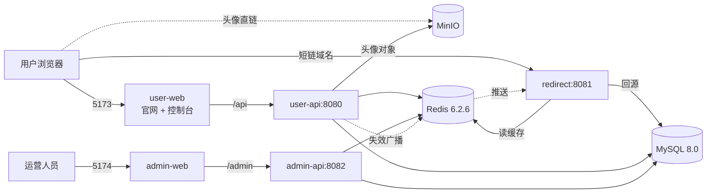
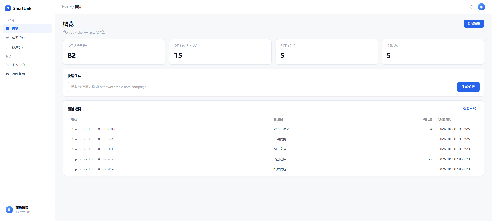
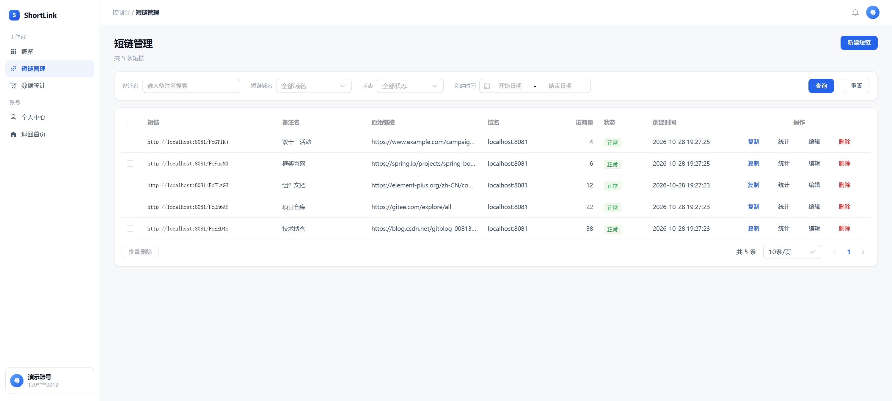
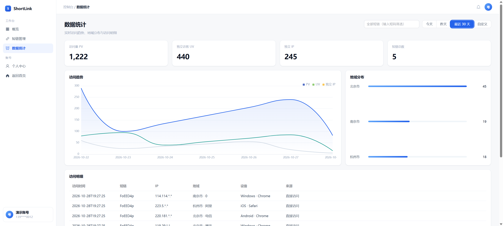
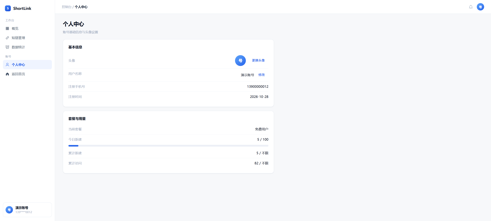
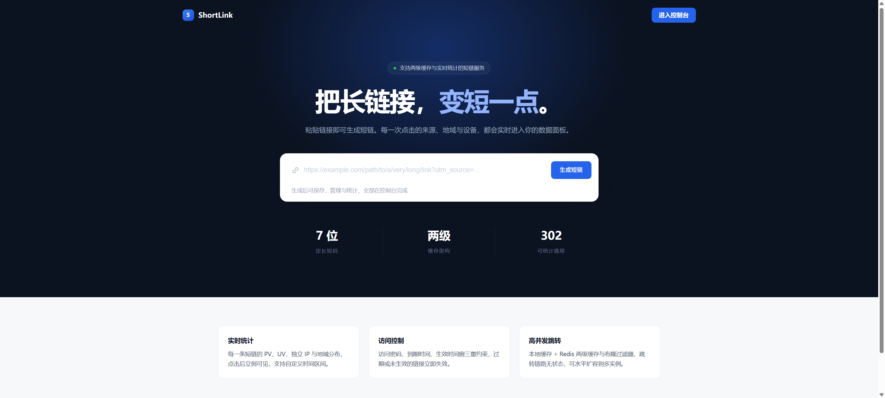
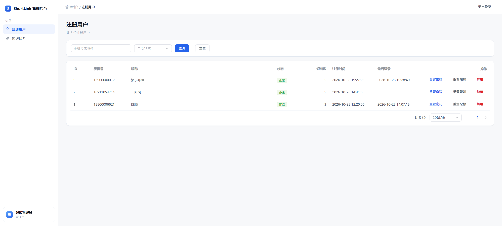

# ShortLink 短链系统

一套可对外提供服务的短链系统，包含用户端、跳转端和后台管理三部分。用户可以注册登录、维护个人资料（昵称、头像）、生成带访问控制的短链、查看实时访问统计；跳转端负责高并发 302 跳转与埋点；后台管理负责注册用户与短链域名的运营。

## 架构



三个后端各自独立部署：跳转端无登录态、不依赖用户端，天生可水平扩容；后台管理建议只在内网或白名单暴露。

## 界面预览

控制台（用户端）：

| 概览 | 短链管理 |
| --- | --- |
|  |  |
| 今日 PV / UV / 独立 IP 与最近短链 | 筛选、批量操作与行内操作 |

| 数据统计 | 个人中心 |
| --- | --- |
|  |  |
| 访问趋势、地域分布与访问明细 | 头像、昵称与套餐用量 |

首页与后台：

| 落地页 | 后台用户管理 |
| --- | --- |
|  |  |
| 粘贴长链接直接生成，登录后可保存与统计 | 禁用、重置密码、重置配额 |

截图里的数据是一次演示导入的样例（5 条短链、82 次访问），不是真实业务数据。

## 技术栈

| 层 | 选型 |
| --- | --- |
| 后端 | JDK 1.8 + Spring Boot 2.7.18 + MyBatis-Plus 3.5.5 |
| 存储 | MySQL 8.0.37（utf8mb4）、Redis 6.2.6、MinIO（头像对象存储） |
| 治理 | Sentinel 1.8.8（流控 / 熔断 / 热点参数）+ Nacos 2.x（规则源） |
| 前端 | Vue 3.5 + TypeScript 5.6 + Vite 5.4 + Element Plus 2.8 |
| 文档 | Knife4j 4.4（`http://localhost:8080/doc.html`） |

Spring Boot 2.7.18 是 JDK 8 能用的最后一版主线，官方 OSS 支持已结束，后续若升级 JDK 17 建议迁到 Spring Boot 3.2。

## 目录结构

```text
short-link/
├─ short-link-common/      公共模块：统一响应、JWT、限流、URL 安全校验、短码、缓存广播
├─ short-link-user-api/    用户端后端 8080
├─ short-link-redirect/    跳转服务 8081
├─ short-link-admin-api/   后台管理后端 8082
├─ frontend/user-web/      用户端前端 5173
├─ frontend/admin-web/     后台管理前端 5174
├─ sql/schema.sql          建表脚本（含分区与初始化数据）
└─ docs/prototype/         视觉原型（静态 HTML，仅供参考）
```

## 本地启动

前置条件：JDK 8、Maven 3.9、Node 18+、MySQL 8、Redis 6.2.6、MinIO（头像对象存储）、Nacos 2.x（规则配置）、Sentinel Dashboard。以下命令假设这些服务都跑在默认端口（Nacos 8848、Dashboard 8858）。

没有 Nacos / Dashboard 也能跑：`shortlink.sentinel.*` 留空即不连它们，只是没有动态规则。

1. 建库建表

```bash
mysql -h127.0.0.1 -uroot -p --default-character-set=utf8mb4 < sql/schema.sql
```

脚本开头的 `SET NAMES utf8mb4` 会强制连接字符集；万一跳过它用客户端导入，表注释和字段注释会被存成乱码（数据本身不受影响）。

2. 启动三个后端（三个终端分别执行）

```bash
mvn -DskipTests package

java -Dfile.encoding=UTF-8 -jar short-link-user-api/target/short-link-user-api-1.0.0.jar
java -Dfile.encoding=UTF-8 -jar short-link-redirect/target/short-link-redirect-1.0.0.jar
java -Dfile.encoding=UTF-8 -jar short-link-admin-api/target/short-link-admin-api-1.0.0.jar
```

3. 启动两个前端

```bash
cd frontend/user-web && npm install && npm run dev
cd frontend/admin-web && npm install && npm run dev
```

4. 访问

| 入口 | 地址 | 账号 |
| --- | --- | --- |
| 用户端 | http://localhost:5173 | 自行注册（验证码 Mock 固定为 `123456`） |
| 后台管理 | http://localhost:5174 | `admin` / `Admin@123456`（首次启动自动创建） |
| 接口文档 | http://localhost:8080/doc.html | — |
| Nacos 控制台 | http://localhost:8848/nacos | 按本机配置 |
| Sentinel 控制台 | http://localhost:8858 | 默认 `sentinel` / `sentinel` |

数据库连接配置在三个服务的 `application.yml` 里，默认 `127.0.0.1:3306`、`root/123456`、Redis 无密码，按本机实际情况修改。

MinIO 只有 `short-link-user-api` 用到，配置在它的 `application.yml`：默认 `http://127.0.0.1:9000`、`admin/12345678`、桶 `short-link`（首次上传时自动建桶并写入桶策略），可用环境变量 `MINIO_ENDPOINT` / `MINIO_ACCESS_KEY` / `MINIO_SECRET_KEY` / `MINIO_BUCKET` 覆盖。`endpoint` 会被直接拼进头像直链，所以必须是浏览器能访问到的地址——从别的机器访问前端时要换成局域网 IP 或域名。

## 关键设计

**短码生成**：MySQL `segment` 表按 1000 一段预取，内存自增后做一次乘法混淆（与 62⁷ 互质的因子，保证一一映射）再 Base62 编成定长 7 位。不依赖哈希碰撞重试，短码也不暴露发号顺序。

**幂等**：`uk_user_domain_hash(user_id, domain_id, url_hash)` 唯一索引兜底。同一用户在同一域名下重复提交同一条长链接，第二次直接返回已有短链并标记 `duplicated: true`。删除时把 `url_hash` 置空，释放这个占位。

**跳转链路**：布隆过滤器挡不存在的短码 → Caffeine 本地缓存 → Redis → MySQL 回源，命中后返回 `302` 并带 `Cache-Control: no-store`（否则浏览器缓存会让统计丢数）。短链被修改或删除时，用户端删 Redis 并向 `sl:link:evict` 频道广播，各跳转实例清掉本地缓存；新建短链则通过 `sl:link:add` 让跳转端把短码加进布隆过滤器。

**埋点与统计**：跳转主链路只把点击事件丢进有界队列（2 万条，满了丢弃并计数），消费线程批量写 Redis 计数（PV 用 INCR、UV/独立 IP 用 HyperLogLog、地域用 Hash）和 `click_log` 明细。每天 00:05 把前一天数据刷进 `link_stat_daily` / `link_stat_region_daily`，查询时「今天走 Redis、历史走汇总表」。

**安全**：长链接在生成时校验协议白名单、拒绝 userinfo、限制端口、DNS 解析后校验实际 IP 是否为内网/保留地址，并禁止指向平台自身域名。跳转端只返回 302，不发起任何外呼，因此不存在「跟随重定向」的 SSRF 面。接口限流用 Redis 有序集合 + Lua 做滑动窗口；用户密码与短链访问密码统一 BCrypt。后台禁用用户后写入 Redis 标记，用户端拦截器每次请求检查一次，禁用立即生效。

**限流分三层**，职责不重叠——同一件事只让一层管，否则出问题分不清是谁拒的：

| 层 | 管什么 | 实现 |
| --- | --- | --- |
| `@RateLimit` | 按用户/IP 的分钟级频率（全局计数） | Redis ZSET + Lua 滑动窗口 |
| `QuotaService` | 每日新建、累计新建、累计访问（累计量） | Redis 计数 + Lua 原子判断，阈值取 `user_quota` 快照 |
| Sentinel | 单机 QPS、热点参数、系统水位（秒级速率） | 规则存 Nacos，改动秒级生效 |

**配额体系**：`quota_package`（套餐模板，目前只有 free 在售）+ `user_quota`（用户配额快照，权威值）+ `user_quota_daily`（日计数对账）。实时计数在 Redis（`sl:q:gen:*` / `sl:q:click:*`），每天 00:10 用 `GREATEST` 覆写回 MySQL，多实例幂等。生成超限返回 `40010` / `40011`；访问超限后由跳转端的 `QuotaLimitService` 把该用户短链置 `quota_blocked=1` 并清缓存，跳转返回 403 提示页。没接支付，恢复靠后台用户列表的「重置配额」按钮（清零用量 + 解除暂停）。

**熔断与降级**：Redis 缓存读包了 `SphU.entry("redis:linkcache")`，熔断期间直接返回 null 降级查库——跳转仍然可用，只是打穿到 MySQL。规则在 `short-link.sentinel.degrade.json`：1 秒内至少 20 次请求、其中过半 RT 超过 200ms 时熔断 10 秒。跳转端的流控与热点参数规则在 `short-link.sentinel.flow.json` / `param-flow.json`（资源名 `redirect:click`，热点参数为 `code`）。

**令牌隔离**：用户端与后台使用不同的 JWT 密钥，令牌互不可用；后台登录另加图形验证码（服务端 AWT 绘制，无额外依赖）。

**双令牌与轮换**：用户端发一对令牌——access 2 小时无状态，refresh 7 天且落 Redis 单值，所以是单会话语义（新登录会顶掉旧 refresh）。刷新时轮换：新 refresh 覆盖 Redis，旧令牌降级到 `sl:auth:refresh:prev:{userId}` 只留 60 秒，用于多标签页同时刷新时收敛到同一个令牌，避免互相踢下线。登出、改密会同时清掉新旧两个 key。前端在 401 时自动刷新并重放原请求，并发的 401 共用一次刷新。

**头像存储**：`user.avatar` 只存 MinIO 对象名（`avatar/{userId}-{uuid}.{ext}`），对外地址由 `endpoint + bucket + 对象名` 拼成，不含签名、不会过期。桶只对 `avatar/` 前缀开匿名只读（`s3:GetObject`），其它对象仍需凭证；接口只收 jpg/png/webp/gif 且不超过 2MB。

## 已知限制

- **地域分布可能显示「未知」/「内网IP」**：`ip2region.xdb`（约 11MB）已随仓库放在 `short-link-redirect/src/main/resources/`。若控制台仍是「未知」，多半是跑着旧构建产物（文件加入前打的 jar），重新 `mvn package` 或重启跳转端即可；若从内网地址（`127.0.0.1` / `192.168.x.x`）访问，内网 IP 本来就没有省市归属，会显示成「内网IP」。
- **后台不物理删除用户**：只提供禁用，避免留下孤儿短链与统计数据。`admin-api` 未实现 `DELETE /admin/user/{id}`。
- **前端包体积偏大**：Element Plus 与 ECharts 均为全量引入，主 chunk 约 1.1MB（gzip 373KB）。要压缩需要改按需引入。
- **`click_log` 分区不会自动滚动**：建表脚本预建了 2026-08 到 2026-12 的分区与 `pmax`，长期运行需要定时 `ALTER TABLE ... ADD PARTITION` 或定期清理。
- **统计聚合任务只在跳转端**：多个跳转实例都会跑 00:05 的聚合，靠 `ON DUPLICATE KEY UPDATE` 保证幂等，但会产生重复计算。生产上应改为单实例执行或加分布式锁。
- **换头像不删旧对象**：每次上传都写一个新对象，旧文件留在 `short-link` 桶里，长期会累积。生产应在上传成功后删旧对象，或给桶配生命周期规则。
- **头像只校验扩展名**：没校验文件头 Magic Number，改后缀的伪装文件能传上去。这个前缀是匿名只读的，不要往里放敏感内容。
- **Sentinel 客户端端口会顺延**：默认 8719，同机跑多个 Sentinel 应用会依次占用 8720/8721。Sentinel 会把实际端口上报给 Dashboard，不影响使用；要固定就加 `-Dcsp.sentinel.api.port`。
- **熔断只覆盖 Redis 缓存读**：MySQL 回源、MinIO 上传都没有单独埋点，这些依赖变慢时 Sentinel 管不到。
- **配额恢复靠手工**：没接支付，超额后只能到后台点「重置配额」，没有自动续期或升级流程。

## 演进预案

当前是单库单表 + 进程内埋点队列。下面三项不是并列关系——前两项做完，第三项基本可以不做：


| 阶段 | 要解决的问题 | 触发阈值 |
| --- | --- | --- |
| 1. RocketMQ 替换进程内队列 | 埋点不丢、消费能力独立扩缩容 | 日点击超 5000 万，或多实例丢数不可接受 |
| 2. ClickHouse 存明细与聚合 | `click_log` 的写入与范围聚合压垮 InnoDB | 日点击超 1000 万 |
| 3. MySQL 分库分表 | 只剩点查表时的容量问题 | 单表超 1 亿行或写入超 2000 TPS |

Sentinel 熔断降级已经落地（见「关键设计」），不再列入预案。

### 1. RocketMQ 替换进程内队列

靶子是 `LocalQueueClickPublisher`（2 万条有界队列，满了丢弃并计数）、`ClickEventConsumer`（单线程攒批 500 条 / 1 秒）、`ClickStatWriter`（Redis pipeline + 批量 insert）。替换后跳转端只负责发消息，消费与落库拆成独立进程。

- **硬约束**：MQ 挂了不能影响 302。用 `sendOneWay` 或异步发，绝不能写成「发消息成功才返回跳转」
- 换来四件事：Broker 持久化（进程重启不丢队列里的数据）、消费位点可重投、多实例统一消费、按时间重放补算统计
- 为什么是 RocketMQ 不是 Kafka：消息量大但结构简单，RocketMQ 更轻、运维成本低、原生支持延迟与事务消息；若确定要让 Kafka 直接喂 ClickHouse 且日点击过亿，再考虑 Kafka

### 2. ClickHouse 存明细与聚合

迁两类数据：

- **明细**：`click_log` 的全部字段，用 MergeTree，按 `toDate(click_at)` 分区、`(code, click_at)` 排序键、TTL 做过期，不再需要手工滚动分区
- **聚合**：现在散在 Redis（今日 PV/UV/IP/地域）和 MySQL（`link_stat_daily`、`link_stat_region_daily`）里的计数，改成从明细物化（AggregatingMergeTree + 物化视图，UV 用 `uniq`），不再依赖 HyperLogLog

迁完能删掉：`StatAggregateJob`（连带多实例重复计算的问题）、两张 `link_stat_*` 表、`StatService` 里「今天走 Redis、历史走汇总表」的分支。

两个坑：明细只追加，删短链不能靠 `UPDATE` 打标；深分页 `LIMIT offset, size` 在 ClickHouse 上很慢，要改成按 `click_at` 游标翻页。

### 3. MySQL 分库分表

做完前两步，留在 MySQL 的只剩 `short_link`、`user`、`domain`、`segment` 这些点查表，分库分表基本可以取消。真要分，目标是 `short_link`：按 `user_id` 分片，但 `uk_code` 的全局唯一会被打破，得改成短码内嵌分片位，或另建一张 code 路由表。

**不要只为了 `click_log` 去分 MySQL**：它的读写模式（只追加、按时间范围聚合、按 code 分页）注定要迁 ClickHouse，在 InnoDB 里分库分表是给一张即将迁走的表做重复投资。

### Sentinel 落地范围

已接入的资源与规则：

| 资源 | 埋点位置 | 现有规则 |
| --- | --- | --- |
| `redirect:click` | `RedirectController` 手动 `SphU.entry`，热点参数为 `code` | 流控 5000 QPS、热点参数 200/秒 |
| `redis:linkcache` | `LinkCacheService` 读 Redis 处 | 慢调用比例熔断（RT>200ms 过半即熔断 10s） |
| `/api/link/generate`、`/api/stat/**`、`/api/user/avatar` | `SentinelWebInterceptor` | 流控 200 QPS |

尚未覆盖的：`admin-api`（接口几乎都带 `{id}` 路径变量，URL 做资源会被拆散，要做得上 `@SentinelResource` 注解式命名）；MySQL 回源与 MinIO 上传也没单独埋点，熔断管不到。

规则改法：直接改 Nacos 里三个 dataId 的 JSON（group `SENTINEL_GROUP`），1~2 秒生效；也可以在 Sentinel Dashboard 改，会写回 Nacos。
